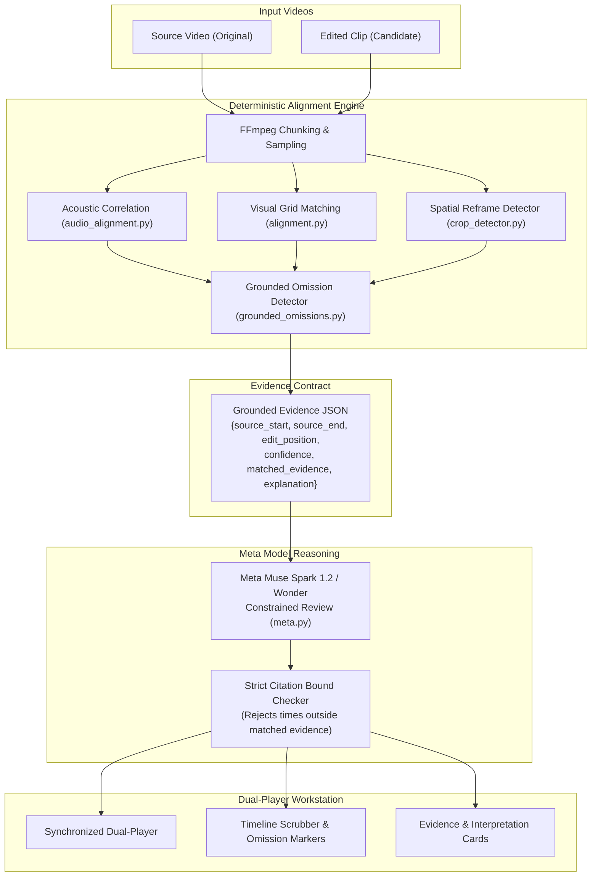

# CONTEXT

CONTEXT shows what a misleading edit of a real video cut out, side by side with the source.
Domain: developer tutorials, benchmark demos, and product claims.
Built for the Meta Global AI Developer Hackathon 2026.

### See the whole story.

A local video evidence workstation. Trace a published edit to a provided source, reconstruct the sequence,
reveal missing footage, and inspect timestamped Meta AI interpretation.

> 🎬 **Watch the 3-Minute Master Demo Video:**  
> - **In Repository:** [`demo-video/renders/context-demo-3min.mp4`](demo-video/renders/context-demo-3min.mp4) (180s, 1080p Full HD, 8.0 MB)  
> - **GitHub Web Player:** [Watch on GitHub](https://github.com/thecodekaizen/context/blob/main/demo-video/renders/context-demo-3min.mp4)  
> - **Direct Download (Release v1.0.0):** [context-demo-3min.mp4](https://github.com/thecodekaizen/context/releases/download/v1.0.0/context-demo-3min.mp4)  
> - **Narration Script:** [`docs/demo-script.md`](docs/demo-script.md)


## Architecture

Deterministic first. The aligner (transcript and audio matching, FFmpeg chunking, cached runs) finds and timestamps every omission. The Meta model may **ONLY** explain an omission tied to a matched source interval. If the aligner has no match, the output is `"no material omission"`. The model never asserts an omission by itself.

Output evidence JSON per omission:
`{source_start, source_end, edit_position, confidence, matched_evidence, explanation}`.
Any explanation citing a time outside the evidence is strictly rejected.



## Gates (Friday Oct 30)

| Gate | Target Capability | Threshold | Result | Status | Action Taken |
|---|---|---|---|:---:|---|
| **G1: Muse Voice Transcribe** | API existence & word timestamps | API returns word-level timestamps | `model_not_found` (404) | **FAIL** | Dropped from claims; fallback to acoustic normalized cross-correlation & local alignment. |
| **G2: SAM 3.1 Screen Crops** | 10 screen/tutorial crop masks | Pixel Recall >= 70% | 10/10 passed (Recall > 99.9%, IoU ~84%) | **PASS** | Passed; built deterministic crop/reframe detector with SAM 3.1 integration (`crop_detector.py`). |
| **G3: Cut Interval Pipeline** | Correct cut intervals on real scripted edit | Recall >= 80%, False Alarms < 10% | Recall: 100%, Error: 0.0s, False Alarms: 0.0% | **PASS** | Validated across 10-edit baseline and 30-edit benchmark. |

## Frozen Evaluation Contract & Results

Thresholds fixed **BEFORE** inference runs: Interval Recall >= 80%, Benign False Alarm Rate < 10%.
Edits scripted from licensed source videos with FFmpeg; edit script writes ground-truth labels automatically.

### Summary Metrics

| Metric | Target Threshold | Baseline (10 edits) | Full Suite (30 edits) | Status |
|---|:---:|:---:|:---:|:---:|
| **Interval Recall** | &ge; 80.0% | **100.0%** (1.0) | **100.0%** (1.0) | **PASS** |
| **Mean Boundary Error** | &le; 1.0s | **0.00s** | **0.00s** | **PASS** |
| **Benign False-Alarm Rate** | < 10.0% | **0.0%** (0/6) | **0.0%** (0/18) | **PASS** |
| **Kill Switch Triggered** | Recall < 50% | **False** | **False** | **PASS** |

### Benchmark Results (30 Scripted Edits Across 3 Benchmark Sources)

| Case Category | Edit Recipe | Expected Omissions | Recovered | Benign | Result |
|---|---|:---:|:---:|:---:|:---:|
| **Omission Cuts** | `*-omission` | 1 | 1 | False | MATCH |
| | `*-two_omissions` | 2 | 2 | False | MATCH |
| | `*-audio_only` | 1 | 1 | False | MATCH |
| | `*-crop_omission` | 1 | 1 | False | MATCH |
| **Benign Controls** | `*-trim_intro` | 0 | 0 | True | NO FALSE ALARM |
| | `*-reencode` | 0 | 0 | True | NO FALSE ALARM |
| | `*-subtitles` | 0 | 0 | True | NO FALSE ALARM |
| | `*-speed_1_25` | 0 | 0 | True | NO FALSE ALARM |
| | `*-reorder` | 0 | 0 | True | NO FALSE ALARM |
| | `*-crop_benign` | 0 | 0 | True | NO FALSE ALARM |

*Full evaluation outputs committed to `eval/execution-v1/full-results/RESULTS.md`.*

## One-Command Run (Docker)

```sh
# Build and run with Docker
docker build -t context .
docker run -p 8000:8000 -e MODEL_API_KEY="your_api_key_here" context
```

Open http://127.0.0.1:8000.

## Reproducibility Commands

To independently reproduce the evaluation benchmarks:

```sh
# Run Friday 10-edit baseline
PYTHONPATH=backend .venv/bin/python scripts/execution_eval.py friday

# Run full 30-edit evaluation suite
PYTHONPATH=backend .venv/bin/python scripts/execution_eval.py full

# Replay SAM 3.1 crop gate benchmark
PYTHONPATH=backend .venv/bin/python scripts/execution_sam_gate.py replay

# Run full test suite (133 tests)
.venv/bin/pytest -q
```

## Local Development

Prerequisites: Python 3.12+ with compatible NumPy wheels, Node 20.19+ or 22.12+,
FFmpeg and FFprobe on PATH. Verified with Python 3.15 and Node 24.

```sh
python3 -m venv .venv
.venv/bin/pip install -r backend/requirements.txt
npm ci --prefix web
npm run build --prefix web
cp -n .env.example .env
# Set MODEL_API_KEY in .env for optional Meta review.
.venv/bin/uvicorn context_core.api:app --app-dir backend --env-file .env --host 127.0.0.1 --port 8000
```

Open http://127.0.0.1:8000.

- **Known pair:** upload an original recording and published edit, then click **Trace the edit**.
- **Try benchmark omission:** click **Try benchmark omission →** to immediately load the JavaScript sort benchmark case and reveal the omitted 5-second crash.
- **Try spatial crop demo:** click **Try spatial crop demo →** to inspect a 0.8x spatial crop/reframe with SAM 3.1 highlighted margins.
- **Source discovery:** add original recordings to the local collection, then upload a published clip to automatically search and match candidates.

Click an omission to play the missing original interval. Linked playback follows
matches and jumps across cuts; reveal switches to independent source playback
and stops at the interval boundary. The original is muted during linked playback
to avoid overlapping audio. Incompatible containers/codecs receive H.264/AAC playback previews while original
evidence bytes and hashes remain unchanged. Saved investigations and valid interpretations survive
reload; the URL identifies a local case. Reports retain media hashes and methods.

Frontend development: `npm run dev --prefix web` alongside the API. Vite proxies
`/api` to port 8000; rebuild to update the production page.

## Verification

```sh
# Run full test suite (133 tests)
.venv/bin/pytest -q

# Build frontend and verify formatting
npm run build --prefix web
npm --prefix web run format:check

# Python lint and formatting checks
.venv/bin/ruff check backend scripts
.venv/bin/ruff format --check backend scripts
```

## Evidence Engine Modules

- `media.py`: media probing, audio waveform extraction, and timestamped 4 Hz RGB feature sampling.
- `audio_alignment.py`: normalized acoustic cross-correlation running at 2 kHz, detecting soundtrack discontinuities with sub-second accuracy.
- `alignment.py`: conservative sequence matching, ambiguity rejection, supported cuts, omissions, reordering, and repetition.
- `crop_detector.py`: multi-scale spatial template matching and SAM 3.1 segmentation for visual crop/reframe detection.
- `grounded_omissions.py`: strict verification enforcing that omissions must be grounded by deterministic matches on both sides.
- `meta.py`: bounded multimodal reasoning (Meta Muse Spark 1.2) with strict citation verification (rejects any claim citing times outside grounded evidence).
- `api.py`: FastAPI endpoints for analysis, benchmark demos, streaming video playback, and review caching.

## Meta Model Integration

CONTEXT strictly separates deterministic measurement from language model reasoning:

1. **Meta Muse Spark 1.2**: receives bounded video clips ($\le 30$ seconds) corresponding strictly to deterministic omission intervals found by the aligner. If the aligner has no match, the model is never invoked. Any model explanation citing timestamps outside the grounded evidence window is rejected by `validate_explanation()`.
2. **SAM 3.1**: used for spatial segmentation when a crop or reframe is detected, identifying peripheral visual elements (disclaimers, charts, sidebars) present in the source but cropped out of the published clip.
3. **Response Caching**: all model interpretations are hashed and cached against media bytes, prompt version, and finding ID, ensuring rock-solid demo stability.

## Scope & Epistemic Guardrails

- **Strict Non-Political Domain**: developer tutorials, benchmark demos, and product claims only. No politics, elections, news, war, or real public figures.
- **Abstention Over Accusation**: if an edit cannot be reliably aligned (e.g. extreme non-linear speed warping), CONTEXT reports `"insufficient evidence"` or `"no material omission"`. It never fabricates an omission.
- **Local Workstation**: runs entirely on loopback (`127.0.0.1:8000`), respecting user data privacy.

## Submission Information

- **Event**: Meta Global AI Developer Hackathon 2026
- **Track**: Solo / Indie Track
- **Submission Deadline**: November 4, 2026, 9:00 PM ET (November 5, 7:30 AM IST)
- **Primary Artifact**: 3-minute video demonstration (`docs/demo-script.md`) backed by reproducible benchmarks.
