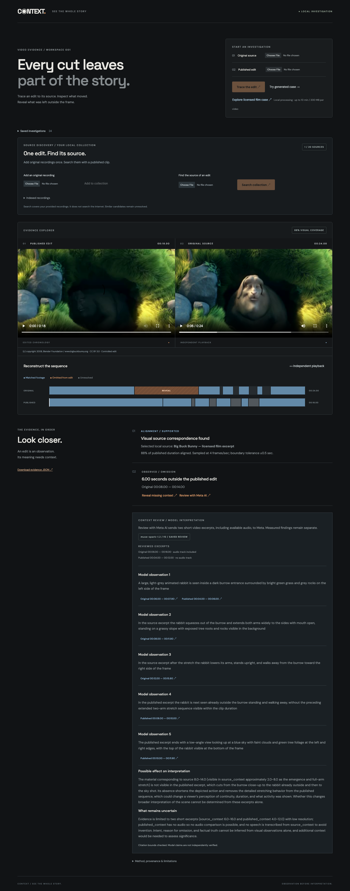

# CONTEXT

### See the whole story.

A local video evidence workstation for the Meta Global AI Developer Hackathon
2026. Trace a published edit to a provided source, reconstruct the sequence,
reveal missing footage, and inspect timestamped Meta AI interpretation.



## Run

Prerequisites: Python 3.12+ with compatible NumPy wheels, Node 20.19+ or 22.12+,
FFmpeg and FFprobe on PATH. Verified with Python 3.15 and Node 24.

```sh
python3 -m venv .venv
.venv/bin/pip install -r backend/requirements.txt
npm ci --prefix web
npm run build --prefix web
cp -n .env.example .env
# Set MODEL_API_KEY in .env for optional Meta review.
.venv/bin/uvicorn context_core.api:app --app-dir backend --env-file .env --host 127.0.0.1 --port 8000
```

Open http://127.0.0.1:8000.

- **Known pair:** upload an original and published edit, then **Trace the edit**.
- **Source discovery:** add original recordings to the local collection, then
  upload a published clip and **Search collection**. Supported matches open the
  evidence explorer; close candidates remain ambiguous. Up to 20 indexed sources.
- **Generated example:** **Try generated case** produces moving FFmpeg footage
  and independently removes seconds 4–8. Inference receives only the files.
- **Production example:** install the optional licensed evaluation below, then
  **Explore licensed film case** to inspect a measured six-second omission.

Click an omission to play the missing original interval. Linked playback follows
matches and jumps across cuts; reveal switches to independent source playback
and stops at the interval boundary. The original is muted during linked playback
to avoid overlapping audio. Incompatible containers/codecs receive H.264/AAC playback previews while original
evidence bytes and hashes remain unchanged. Saved investigations and valid interpretations survive
reload; the URL identifies a local case. Reports retain media hashes and methods.

Frontend development: `npm run dev --prefix web` alongside the API. Vite proxies
`/api` to port 8000; rebuild to update the production page.

## Verify

```sh
.venv/bin/pytest -q
npm run build --prefix web
npm --prefix web run format:check
cd web
npx playwright install chromium
npm run test:e2e
```

51 backend tests pass with optional production footage installed; 11 of them skip
without it. Eight browser tests cover generated evidence, reveal, download,
mobile layout, explicit provider error, citation seeking, indexed source discovery,
ambiguity, reload recovery and production attribution. The API must be running.
Provider-shape tests and UI response fixtures are explicitly mocked. A separate
credentialed walkthrough has completed live Meta inference and reload recovery.

Formatting/lint tools: install `backend/requirements-dev.txt`, then use
`.venv/bin/ruff check backend scripts` and `.venv/bin/ruff format --check backend scripts`.
React formatting: `npm --prefix web run format`.

## Production-footage evaluation

```sh
PYTHONPATH=backend .venv/bin/python scripts/evaluate.py --download
```

Downloads an approximately 65 MB licensed Blender source into ignored
`data/evaluation`, generates controlled edits and writes a measured report.
The production example becomes available after refreshing the app.

The six supported copy/edit/compression cases correctly identify expected edit
types, with all accepted sampled correspondences within 0.5 seconds of ground
truth on this excerpt. Unsupported brightness/crop cases remain insufficient;
tested speed changes are rejected. This is a small regression set, not a claim
of general accuracy. See [measurements and defects fixed](docs/evaluation.md).

## Evidence engine

- `media.py`: media probing and timestamped 4 Hz RGB samples at 24×16 pixels.
- `alignment.py`: conservative sequence matching, ambiguity rejection, supported
  cuts, omissions, reordering and repetition. Sustained speed changes invalidate
  1× mappings. Unresolved material never becomes a confirmed omission by itself.
- `library.py`: persistent source indexing, exact-content deduplication, cached
  fingerprints and margin-based source selection. Each edit is decoded once
  per collection search. Near-duplicate recordings remain unresolved.
- `context_pack.py`: bounded source/edit video excerpts with retained audio.
- `meta.py`: optional multimodal interpretation and timestamp validation.
- `api.py`: uploads, local search, byte-range playback, saved cases and reviews.

JSON includes SHA-256 hashes, method, similarity score, segments, findings,
diagnostics and limitations. Scores are not calibrated probabilities. Boundary
tolerance is ±0.5 seconds. The command-line pair/multi-source tool remains available:

```sh
PYTHONPATH=backend .venv/bin/python -m context_core data/demo/edited.mp4 data/demo/original.mp4 --output /tmp/context-evidence.json
```

The CLI performs direct comparisons and decodes each supplied source. Persistent
cached retrieval is exposed through the collection API and UI.

## Meta integration

Official docs and credentialed compatibility were verified; see
[Meta verification](docs/meta-verification.md). **Review with Meta AI** sends two
short video excerpts with available embedded audio to Meta. This transfer occurs
on an explicit review action. Source clips are capped at 30 seconds and 8 MB each;
long findings require manual inspection. No entire source library is sent.

Muse Spark 1.2 is selected because Meta's current video/audio guide cautions about
1.3 audio quality. Model observations require valid supplied clip IDs and bounded
local timestamps. The server translates citations to media times; clicking one
seeks the corresponding player. Reviewed excerpt ranges and audio availability
are visible, as are possible interpretation and uncertainty. Checked timestamps
are not independent verification of model claims.

Valid reviews are cached against media hashes, finding, analysis method, model
and prompt version. Cache reuse is labeled. Stale reviews are withheld. Missing
credentials, provider errors or invalid citations leave measured evidence intact.

## Walkthrough and submission assets

```sh
node scripts/record-walkthrough.mjs
# Or reuse a previously saved case without another inference:
node scripts/record-walkthrough.mjs CASE_ID
```

Requires the server, licensed film example, Playwright Chromium and a configured
Meta key for an uncached review. Creates a silent browser QA recording under
ignored `data/walkthrough`. It uses the actual app and provider, no mocked findings.
The raw recording is not the final narrated submission video.

The narrated 3:00, 1920×1080 MP4 is at
`demo-video/renders/context-demo-3min.mp4` (generated, ignored). It uses actual
captures, local synthesized narration and a clearly labeled saved real Meta
response. The film example and evaluation limits are disclosed. No submission
or public upload has been performed.

[Editable demo and rebuild instructions](demo-video/README.md) ·
[Three-minute script](docs/demo-script.md) · [Submission draft](docs/submission.md)

## Scope

Local trusted workstation; bind to loopback. Up to 10 minutes and 200 MB per
upload, one analysis at a time per server process. Videos and reports persist
under ignored `data/`. No internet-wide retrieval, factual verdict, intent
inference or deepfake detection. Static/repeated scenes, heavy crops, overlays,
large color changes and speed changes need broader evaluation or stronger models.
FFmpeg has timeouts and duration limits but no isolated decoder environment;
public hosting and accounts are outside the current local MVP.

## Attribution

Film excerpts and application captures: *Big Buck Bunny* (2008), (c) copyright
2008, Blender Foundation / www.bigbuckbunny.org. CC BY 3.0. Footage trimmed,
transcoded and edited for controlled evaluation. [Source and license](https://peach.blender.org/about/).

Deadline: November 4, 2026, 9 PM ET (November 5, 7:30 AM IST).
