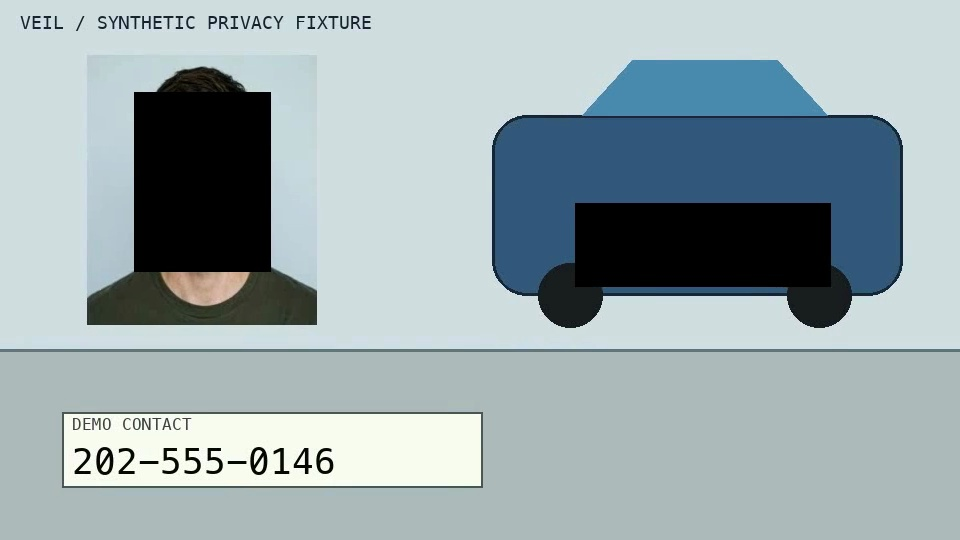

# VEIL — Multimodal Video Privacy Engine

**Detect. Redact. Verify.**

VEIL is an API-first multimodal video privacy engine built for the Meta Global AI Developer Hackathon 2026. It identifies sensitive visual and spoken information (faces, plates, telephone numbers, and speech), renders time-aligned frame-accurate redactions, inspects exported pixels for residual exposures, and repairs detected misses with cryptographic receipts.

- **Core Python Engine, API & SDK**: [`veil/`](veil/)
- **Reference Video Inspection Desk**: [`veil/web/`](veil/web/)
- **API Contract & Pipeline Architecture**: [`veil/docs/PIPELINE_API.md`](veil/docs/PIPELINE_API.md)
- **Live Pipeline Evaluation**: [`veil/docs/LIVE_EVALUATION.md`](veil/docs/LIVE_EVALUATION.md)
- **Verifier Benchmark Protocol**: [`veil/docs/BENCHMARK_PROTOCOL.md`](veil/docs/BENCHMARK_PROTOCOL.md)

---

## The Hero Moment: Catching an Omitted Placard Number

| Initial Export: Omitted Phone Number (00:07.500) | Corrected Export: Whole-Field Repair (00:07.600) |
|---|---|
|  |  |

The initial redaction export covered the driver face and vehicle license plate, but left the printed delivery phone number unredacted. The post-export verifier caught the residual text on exported pixels, rejected a single-digit repair attempt, and produced a verified whole-field export that passed a 3-frame sampled review (`00:02.000`, `00:07.600`, `00:16.000`).

---

## Reference Demonstration Desk


```sh
cd veil/web
npm install
npm test
npm run dev
```

Visit `http://localhost:3000` to interact with the recorded demonstration or connect to the local engine API at `http://127.0.0.1:8019`.

---

## Historical Archives (SHOWME & THREAD)

The preceding instructions and prototype surfaces for SHOWME and THREAD remain historical context preserved under `apps/web/` and `docs/archive/`. They do not direct active VEIL development.

<details>
<summary>Expand Historical SHOWME Prototype Documentation</summary>

### Build a process model from a demonstration.

Use the same model to inspect a learner’s attempt and test a different step order.

## Agent handoff

Start with [ANTIGRAVITY.md](ANTIGRAVITY.md) for product scope, design specifications, editable wireframes, contracts, decisions and the implementation backlog.

## The problem

Videos and manuals show a procedure, but they cannot inspect the learner’s workspace. SHOWME is a prototype for turning one task video into a reviewable process model, then comparing selected frames or a separate recording with that model.

## The product

SHOWME builds one evidence-linked **Process Model** from a bounded physical procedure. The same model supports three connected surfaces:

1. **Teach** — Record or upload a demonstration and optionally attach the task's official instructions. SHOWME keeps intended steps from the reference separate from actions observed in the video, then proposes a process model for human review.
2. **Do** — Check a selected camera frame or analyze a separate learner recording against the reviewed model. Inspect reported differences in the video.
3. **Simulate** — Change an action order and play through the resulting modeled states. The current simulator does not model physical forces or geometry.

The shared process model connects Teach, Do, and Simulate. The hackathon targets one safe, visually clear task. The prototype does not provide continuous tracking, proven recovery guidance, arbitrary task learning, or general-purpose physics.

## Current app screenshots

These screenshots were captured from the production build on October 27, 2026 at 1440 px width, before the current copy and navigation update. They include the blocked-attempt preview. Simulate uses an explicitly illustrative stacked-mount fixture. The Do screenshot shows the camera-off starting view; SAM grounding appears only after an explicit model call on a selected frame. The images show prototype flows, not proof that physical mistakes are reliably detected.

| Teach | Do |
|---|---|
|  |  |

| Simulate | What-if result |
|---|---|
|  |  |

</details>

## Product design concepts

These are design references, not screenshots of implemented screens or proof that physical-task understanding works. The depicted block assembly is illustrative; the evaluation task will be selected after inspecting the LEGO set.


See the [full mockup inventory](design/mockups/README.md) for the Do and Simulate concepts and their limitations.

## What works now

- **Teach**:
  - Captures a demonstration from browser camera or video upload with optional narration.
  - Accepts an optional official instructions PDF; Muse Spark cites manual page/step evidence distinctly from empirical video timestamps.
  - Interactive clickable evidence timestamp badges seek the demonstration video player directly to cited moments.
  - In-browser candidate review includes an audited human revision trail: reviewers can correct object labels or action names prior to activation, with full diff and single-click revert capability.
  - Candidate model prerequisites remain unverified hypotheses unless explicitly confirmed against an observed state.
- **Do**:
  - Discrete camera frame checks against the reviewed process model, with an in-flight check indicator and graceful rejected-result recovery that preserves trustworthy history.
  - Task checkpoint guidance derives unambiguous vs ambiguous next actions, part lists, and observable fact checklists directly from the shared Skill Model.
  - Analyzes separate learner video recordings and provides an evidence-first recovery panel: identifies affected parts, navigates to the latest divergence, and verifies whether subsequent matching frames occurred.
- **Simulate**:
  - Procedural simulation driven by the single shared Skill Model (with task-specific LEGO 30727 vector silhouettes or illustrative fixtures, explicitly disclosing geometry provenance).
  - Can launch exploration directly from camera frame checkpoints, with a safe "Return to active task" flow that clears transient simulation states while preserving physical history and explaining camera lifecycle teardown.
  - Deterministic sequence execution with natural language what-if reordering ("Move step A before step B").
  - Automated recovery resolution: detects blocked prerequisites or unobserved transitions (honestly labeled *"not established by this model"*), checks candidate prerequisite actions against current simulated state, and re-tests the repaired sequence to report remaining blockers.
- **Persistence & Privacy**:
  - Skill candidates, human-confirmed constraints, and revisions persist in browser-local storage. Uploaded clips and frames remain private to the user's session.

The simulation illustrates modeled states and sequence constraints; it is not a physics or spatial collision simulator. The full end-to-end evaluation pipeline uses the LEGO 30727 safe assembly task.

## Run locally

From the repository root, install the optional API dependencies and start the local SHOWME API:

```sh
python3 -m venv backend/.venv
backend/.venv/bin/pip install -e 'backend[api,meta]'
PYTHONPATH=backend backend/.venv/bin/uvicorn showme.api:app --reload --port 8000
```

Set `MODEL_API_KEY` in the repository’s ignored local `.env` file or in the API process environment. Never commit the key. Model calls can use hackathon API credits.

In a second terminal, start the web app:

```sh
cd apps/web
npm install
npm run dev
```

Open [http://localhost:3000](http://localhost:3000). The app uses the local API at `http://localhost:8000` by default.

## Product and build documents

- [Locked product definition](docs/PRODUCT.md)
- [Hackathon build plan and evidence status](docs/SHOWME_BUILD_PLAN.md)
- [Proof-of-magic experiment](docs/SHOWME_PROOF_OF_MAGIC.md)
- [Final app plan](docs/SHOWME_APP_PLAN.md)
- [Interactive simulation design](docs/SHOWME_SIMULATION_DESIGN.md)
- [Three-minute demo flow](design/flows/demo-flow.md)
- [Daily progress log](docs/DAILY_LOG.md)

## Meta model roles

Muse Spark performs structured interpretation of demonstrations and learner observations. In Do, SAM 3.1 can segment one selected Skill Model object on either a manual camera snapshot or a user-selected timestamp from a recorded learner divergence. Both are opt-in single-frame calls; neither is live tracking. The integration uses Meta's official `meta-sam-parser` to decode segmentation records. Muse Voice is still a possible later addition. SAM has not yet been validated on the chosen LEGO task or against real footage from a separate learner.

## Hackathon and responsible use

Meta Global AI Developer Hackathon 2026 · Indie Developer / Push the Frontier. The submission needs a public repository and a demo video of at most three minutes. Clearly identify work created during the October 27–November 4 build period.

Use safe tasks and footage you have permission to record and share. Avoid faces and private details. Do not commit API keys, private recordings, raw model payloads, or evaluation labels. SHOWME provides guidance; it does not control tools or machinery.
