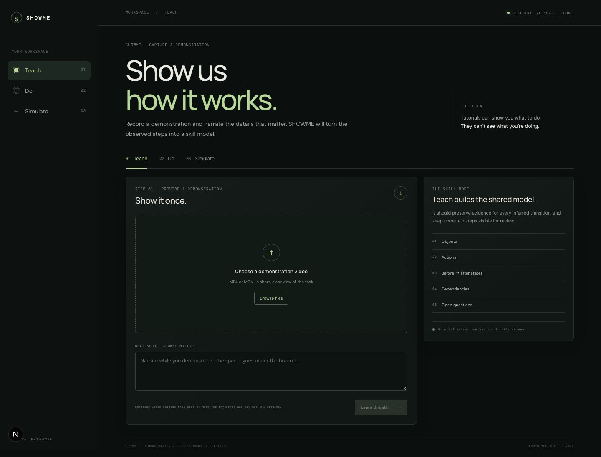
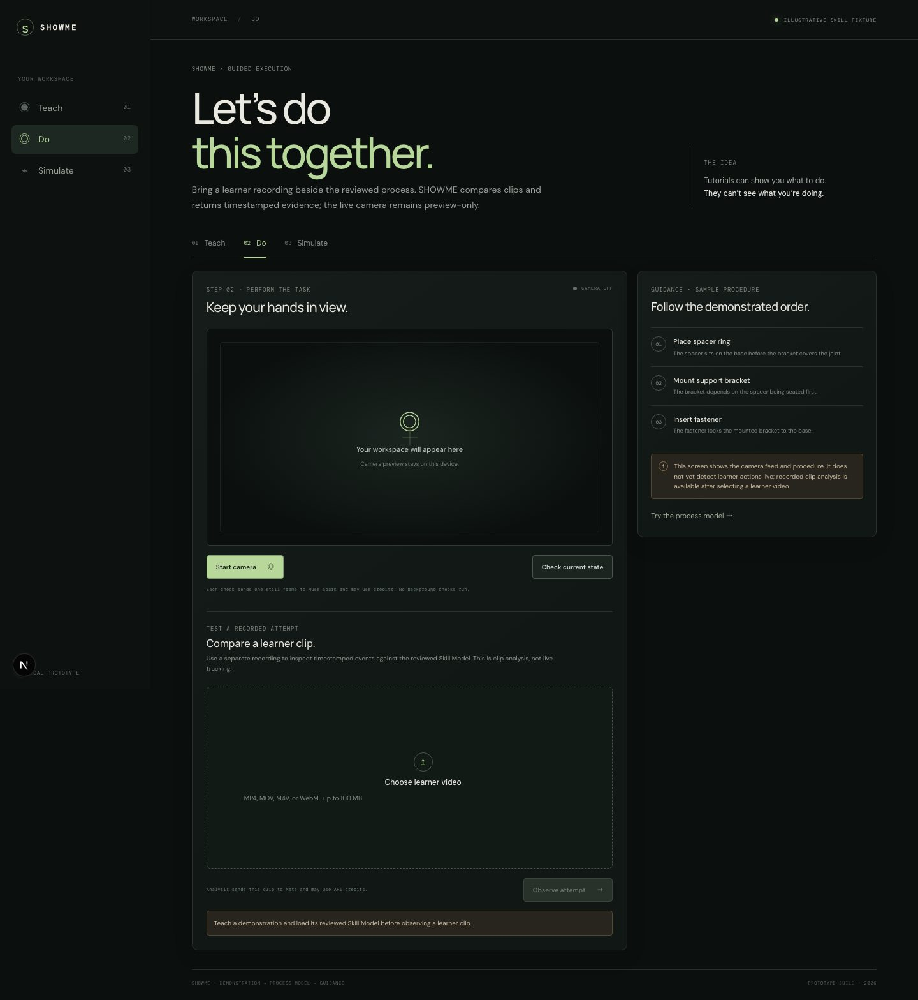
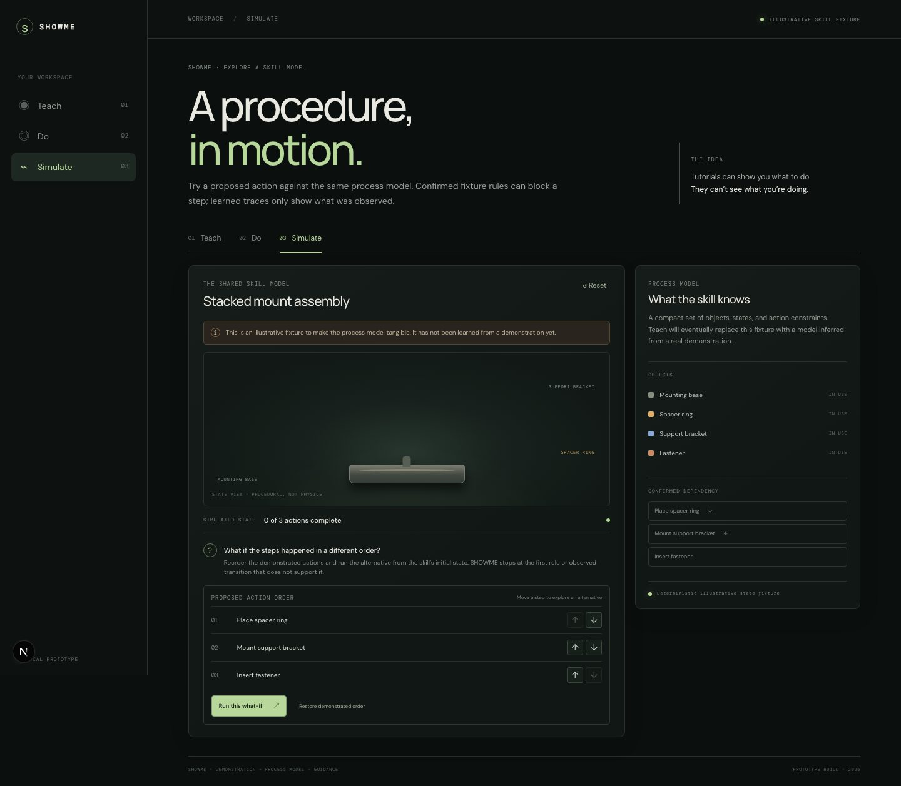
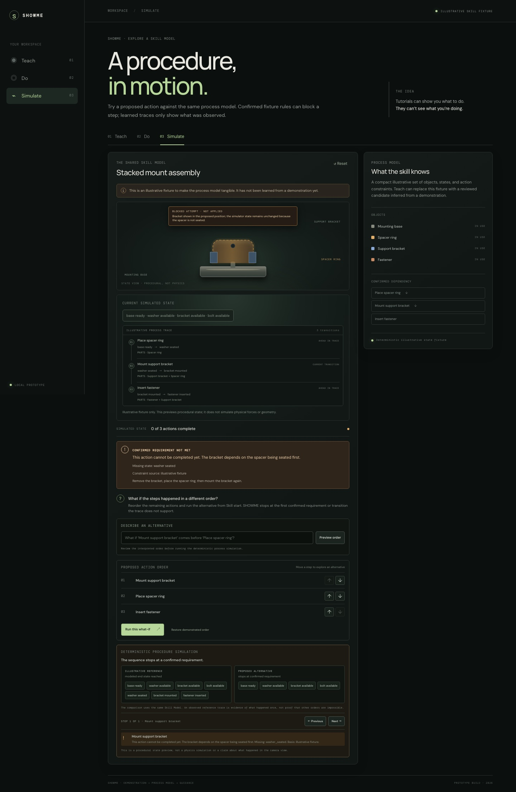
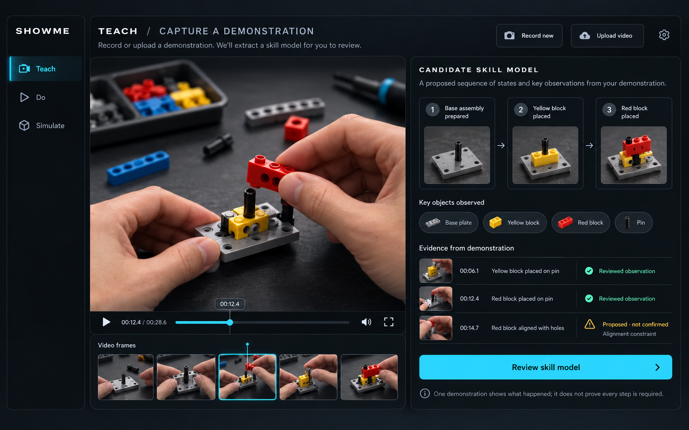

# SHOWME

### Tutorials can show you what to do. They can’t see what you’re doing.

**SHOWME turns demonstrations into understanding.** Show it once. Learn it. Simulate it. Teach it.

## The problem

People learn physical tasks from videos and manuals, but those resources cannot see the learner’s workspace. They cannot tell that a part is missing, an action was done out of order, or the learner has recovered from a mistake. SHOWME aims to connect an expert’s demonstration to the learner’s actual task state.

## The product

SHOWME learns one bounded physical procedure as an evidence-linked **Skill Model**. That same model powers three connected surfaces:

1. **Teach** — Record or upload an expert demonstration. SHOWME proposes objects, actions, observable states, transitions, and possible dependencies for human review.
2. **Do** — Observe a learner’s separate attempt, compare it with the reviewed Skill Model, explain supported differences, and guide recovery.
3. **Simulate** — Change the action order and explore the resulting procedural state using that same Skill Model.

The Skill Model is the product: Teach creates it; Do executes against it; Simulate explores it. The hackathon targets one safe, visually clear task. It does not claim arbitrary task learning or general-purpose physics.

## Current app screenshots

These are screenshots of the local app captured October 27, 2026. They predate the optional SAM still-frame grounding control and blocked-attempt visual preview. Simulate uses an explicitly illustrative stacked-mount fixture. Do offers camera preview, one-frame checks, recorded-clip comparison, and optional single-frame grounding; it does not track continuously. The images show prototype flows, not proof that physical mistakes are reliably detected.

| Teach | Do |
|---|---|
|  |  |

| Simulate | What-if result |
|---|---|
|  |  |

## Product design concepts

These are design references, not screenshots of implemented screens or proof that physical-task understanding works. The depicted block assembly is illustrative; the evaluation task will be selected after inspecting the LEGO set.



See the [full mockup inventory](design/mockups/README.md) for the Do and Simulate concepts and their limitations.

## What works now

- Teach can capture a short demonstration from the browser camera or accept an uploaded video and narration, save the clip locally, then ask Muse Spark for a structured candidate Skill Model with timestamped evidence.
- A person reviews the candidate. Model-proposed prerequisites remain hypotheses unless explicitly mapped to a state and confirmed by the reviewer.
- Do can capture and save a learner clip in-browser or accept an upload, then compare it with the reviewed Skill Model; it can also request a single camera-frame check. These are discrete observations, not continuous tracking.
- Simulate lets a person reorder actions, step through a deterministic procedural replay, and inspect the first confirmed blocker. A sequence absent from one demonstration is reported as **unobserved**, not impossible.
- Skill candidates and human-reviewed constraint mappings persist in browser-local storage. Uploaded clips and camera frames are not stored by the app after the request.

The current simulation view is procedural rather than a geometry or physics simulator. The matched demonstration / correct attempt / mistake / recovery evaluation is still pending with the selected task.

## Run locally

From the repository root, install the optional API dependencies and start the local SHOWME API:

```sh
python3 -m venv backend/.venv
backend/.venv/bin/pip install -e 'backend[api,meta]'
PYTHONPATH=backend backend/.venv/bin/uvicorn showme.api:app --reload --port 8000
```

Set `MODEL_API_KEY` in the repository’s ignored local `.env` file or in the API process environment. Never commit the key. Model calls can use hackathon API credits.

In a second terminal, start the web app:

```sh
cd apps/web
npm install
npm run dev
```

Open [http://localhost:3000](http://localhost:3000). The app uses the local API at `http://localhost:8000` by default.

## Product and build documents

- [Locked product definition](docs/PRODUCT.md)
- [Hackathon build plan and evidence status](docs/SHOWME_BUILD_PLAN.md)
- [Proof-of-magic experiment](docs/SHOWME_PROOF_OF_MAGIC.md)
- [Final app plan](docs/SHOWME_APP_PLAN.md)
- [Interactive simulation design](docs/SHOWME_SIMULATION_DESIGN.md)
- [Three-minute demo flow](design/flows/demo-flow.md)
- [Daily progress log](docs/DAILY_LOG.md)

## Meta model roles

Muse Spark performs structured interpretation of demonstrations and learner observations. In Do, SAM 3.1 can segment one selected Skill Model object on either a manual camera snapshot or a user-selected timestamp from a recorded learner divergence. Both are opt-in single-frame calls; neither is live tracking. The integration uses Meta's official `meta-sam-parser` to decode segmentation records. Muse Voice is still a possible later addition. SAM has not yet been validated on the chosen LEGO task or against real footage from a separate learner.

## Hackathon and responsible use

Meta Global AI Developer Hackathon 2026 · Indie Developer / Push the Frontier. The submission needs a public repository and a demo video of at most three minutes. Clearly identify work created during the October 27–November 4 build period.

Use safe tasks and footage you have permission to record and share. Avoid faces and private details. Do not commit API keys, private recordings, raw model payloads, or evaluation labels. SHOWME provides guidance; it does not control tools or machinery.
