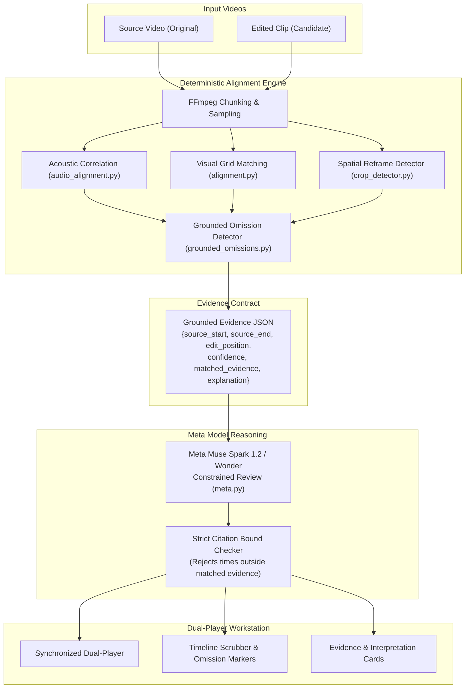

# CONTEXT

CONTEXT shows what a misleading edit of a real video cut out, side by side with the source.
Domain: developer tutorials, benchmark demos, and product claims.
Built for the Meta Global AI Developer Hackathon 2026.

### See the whole story.

A local video evidence workstation. Trace a published edit to a provided source, reconstruct the sequence,
reveal missing footage, and inspect timestamped Meta AI interpretation.

> 🎬 **Watch the 3-Minute Master Demo Video:**  
> - **In Repository:** [`demo-video/renders/context-demo-3min.mp4`](demo-video/renders/context-demo-3min.mp4) (180s, 1080p Full HD, 8.0 MB)  
> - **GitHub Web Player:** [Watch on GitHub](https://github.com/thecodekaizen/context/blob/main/demo-video/renders/context-demo-3min.mp4)  
> - **Direct Download (Release v1.0.0):** [context-demo-3min.mp4](https://github.com/thecodekaizen/context/releases/download/v1.0.0/context-demo-3min.mp4)  
> - **Narration Script:** [`docs/demo-script.md`](docs/demo-script.md)


## Architecture

Deterministic first. The aligner (4 Hz spatial color sequence matching via `spatial-color-sequence-v2` and normalized acoustic cross-correlation) finds and timestamps every omission. The Meta model may **ONLY** explain an omission tied to a matched source interval. If the aligner finds no correspondence, the output is strictly `"no material omission"` with an abstention limitation. The model never discovers or invents an omission independently of grounding.

Output evidence JSON per omission:
`{source_start, source_end, edit_position, confidence, matched_evidence, explanation}`.
Any explanation citing a time outside the bounded evidence window is strictly rejected.



## Interface Walkthrough & Real Use Cases

### 1. Synchronized Dual-Player Workbench (`01 WORKBENCH`)


- **Purpose:** Primary forensic evidence workspace. Synchronizes the candidate published edit alongside the unedited source recording into an aligned timeline with an interactive 4 Hz visual confidence strip, audio waveforms, omission markers, and tabular millisecond readouts.
- **Real Run / Authored Case:** **Python Cache Latency Qualification Demonstration**
  - *The Footage:* Authored technical illustration displaying actual local microtimings (PBKDF2 cold setup vs dictionary lookup). A conditions panel at seconds 6–10 explicitly discloses `"WARM CACHE ONLY"`, `"COLD-START SETUP IS EXCLUDED"`, and `"Not an end-to-end speedup claim"`.
  - *The Temporal Edit:* Excises source seconds `00:06.000` to `00:10.000`, removing the qualification while leaving the measured lookup figure intact.
  - *The Detection:* Given only the edited clip, CONTEXT selects the registered source, reconstructs the timeline via acoustic correlation, recovers the exact 6–10 s deletion at edit position 6.000 s, and dispatches bounded excerpts plus timed 720p frames to **Meta Muse Spark 1.2**.
  - *The Interpretation:* Muse Spark 1.2 reads the qualification in source frames, notes generic conditions in edited samples, and explains the potential interpretive impact while honestly reporting `inconclusive` on whether the qualification disappeared throughout the edit.
- **Supporting Controlled Run:** **JavaScript Sort Benchmark (5-Second Deletion)**
  - Recovers the 5.000–10.000 s deletion from the CC0 sort benchmark. Muse observes the benchmark header, qualification text, and measurements; semantic effect remains inconclusive.

---

### 2. Spatial Forensics & Crop Calipers


- **Purpose:** Detects spatial reframing, aspect-ratio crops, and peripheral panel omissions.
- **Real Run / Real Use Case:** **Cache Conditions Panel Spatial Cut**
  - *The Edit:* Retains `[0, 0, 960, 720]` of a `1280×720` frame, shaving off the rightmost 25% margin containing the test conditions panel.
  - *The Detection:* Deterministic OpenCV multi-scale template matching identifies the exact retained box and highlights omitted margins with HUD calipers.
  - *Meta SAM 3.1 Status:* SAM 3.1 is an experimental segmentation model. A frozen 10-crop chart-bar experiment passes (>99.9% pixel recall on saved replay). A live test on the cache qualification panel returned zero masks (failed). Operational margin shading is computed strictly by deterministic OpenCV geometry.

---

### 3. Frozen Benchmark & Evaluation Matrix Hub (`02 EVALUATION`)


- **Purpose:** Transparency and reproducibility scorecard for frozen fixtures.
- **Real Run / Real Use Case:** **30-Edit Benchmark Suite & 18 Benign Controls**
  - Evaluates 30 scripted FFmpeg edits across 3 CC0 benchmark videos (`sort.mp4`, `cache.mp4`, `serialize.mp4`) across 10 recipes.
  - **Empirical Results:** `100% Interval Recall` (15/15 intervals recovered across 12 positive cases), `0.0s Boundary Error`, `0.0% Benign False Alarms` across 18 benign controls (speedups, trims, subtitles, compression).
  - **Failure Boundary Disclosed:** Evaluated on real-world terminal footage (`hyperfine` benchmark animation). Visual coverage fell below the 60% threshold on repetitive frames, resulting in an honest abstention (*"no material omission"* with limitations).

---

### 4. Verification Intake & Technical Catalog Ingestion


- **Purpose:** Single-input intake for candidate published edits, operator-reviewed technical catalog lookup, and domain policy enforcement.
- **Real Run / Real Use Case:** **Single-Edit Investigation**
  - Users submit an edited video. The pipeline verifies content admission against the domain policy (developer tutorials, benchmarks, product claims).
  - Catalog retrieval compares admitted candidates deterministically.
  - Presets allow instant inspection of verified forensic cases and saved dossiers.

---

## Capabilities & Validation Matrix

| Capability | Component | Status | Empirical Evidence & Boundaries |
|---|---|:---:|---|
| **Temporal Omission Recovery** | 4 Hz spatial color sequence (`spatial-color-sequence-v2`) & normalized acoustic correlation | **Measured / Passing** | 15/15 intervals recovered across 12 positive cases in frozen `execution-v1` (30 cases total), 0.0 s mean boundary error, 0/18 benign alarms. Exact recovery of 6–10 s deletion in cache qualification case. Fails on repetitive terminal animation (hyperfine candidate: 46.3% coverage, abstains). |
| **Spatial Crop Bounds** | Multi-scale template matching (`crop_detector.py`) | **Measured / Passing** | Exact retained box `[0, 0, 960, 720]` (25% area cut) on cache crop fixture; caliper geometry isolates omitted margins. |
| **Grounded Semantic Review** | Meta Muse Spark 1.2 (`meta.py`, `context-review-v5-bounded-frames`) | **Integrated / Bounded** | Requests bounded to measured omissions (<=2 clips, <=30 s, 3 timed 720p frames each). Citations strictly bounds-checked. Reads cache qualification, observes generic edit conditions, and reports `inconclusive`. Valid timestamps do not prove semantic accuracy. |
| **Screen-Content Segmentation** | Meta SAM 3.1 (`scripts/run_sam_gate.py`, `scripts/run_cache_qualification_sam.py`) | **Experimental** | Replay of 10 frozen chart-bar crops passes (>99.9% pixel recall, ~84% IoU). Standalone live panel test with concept prompt returned zero masks (failed). Operational crop margins use OpenCV geometry, not SAM masks. |
| **Technical Source Discovery** | Registered catalog & local collection (`library.py`) | **Bounded Scope** | Ranks up to 4 registered technical sources + local collection (capped at 20). Untrusted captions rank metadata; deterministic correspondence independently selects media. Not internet-wide reverse search. |
| **Content Admission Gate** | Fail-closed domain policy (`domain_policy.py`) | **Enforced Policy** | Restricts to developer tutorials, benchmarks, product demos. Excludes politics, elections, news, wartime, public figures. Local operator receipts bind exact SHA-256; not an automatic classifier. |

## Frozen Evaluation Contract & Results

Thresholds fixed **BEFORE** inference runs: Interval Recall >= 80%, Benign False Alarm Rate < 10%.
Edits scripted from licensed source videos with FFmpeg; edit script writes ground-truth labels automatically.

### Summary Metrics

| Metric | Target Threshold | Baseline (10 edits) | Full Suite (30 edits) | Status |
|---|:---:|:---:|:---:|:---:|
| **Interval Recall** | &ge; 80.0% | **100.0%** (1.0) | **100.0%** (1.0) | **PASS** |
| **Mean Boundary Error** | &le; 1.0s | **0.00s** | **0.00s** | **PASS** |
| **Benign False-Alarm Rate** | < 10.0% | **0.0%** (0/6) | **0.0%** (0/18) | **PASS** |
| **Kill Switch Triggered** | Recall < 50% | **False** | **False** | **PASS** |

### Benchmark Results (30 Scripted Edits Across 3 Benchmark Sources)

| Case Category | Edit Recipe | Expected Omissions | Recovered | Benign | Result |
|---|---|:---:|:---:|:---:|:---:|
| **Omission Cuts** | `*-omission` | 1 | 1 | False | MATCH |
| | `*-two_omissions` | 2 | 2 | False | MATCH |
| | `*-audio_only` | 1 | 1 | False | MATCH |
| | `*-crop_omission` | 1 | 1 | False | MATCH |
| **Benign Controls** | `*-trim_intro` | 0 | 0 | True | NO FALSE ALARM |
| | `*-reencode` | 0 | 0 | True | NO FALSE ALARM |
| | `*-subtitles` | 0 | 0 | True | NO FALSE ALARM |
| | `*-speed_1_25` | 0 | 0 | True | NO FALSE ALARM |
| | `*-reorder` | 0 | 0 | True | NO FALSE ALARM |
| | `*-crop_benign` | 0 | 0 | True | NO FALSE ALARM |

*Full evaluation outputs committed to `eval/execution-v1/full-results/RESULTS.md`.*

## One-Command Run (Docker)

```sh
# Build and run with Docker
docker build -t context .
docker run -p 8000:8000 -e MODEL_API_KEY="your_api_key_here" context
```

Open http://127.0.0.1:8000.

## Reproducibility Commands

To independently reproduce the evaluation benchmarks:

```sh
# Run Friday 10-edit baseline
PYTHONPATH=backend .venv/bin/python scripts/execution_eval.py friday

# Run full 30-edit evaluation suite
PYTHONPATH=backend .venv/bin/python scripts/execution_eval.py full

# Replay SAM 3.1 crop gate benchmark
PYTHONPATH=backend .venv/bin/python scripts/execution_sam_gate.py replay

# Run full test suite (171 tests)
.venv/bin/pytest -q
```

## Local Development

Prerequisites: Python 3.12+ with compatible NumPy wheels, Node 20.19+ or 22.12+,
FFmpeg and FFprobe on PATH. Verified with Python 3.15 and Node 24.

```sh
python3 -m venv .venv
.venv/bin/pip install -r backend/requirements.txt
npm ci --prefix web
npm run build --prefix web
cp -n .env.example .env
# Set MODEL_API_KEY in .env for optional Meta review.
.venv/bin/uvicorn context_core.api:app --app-dir backend --env-file .env --host 127.0.0.1 --port 8000
```

Open http://127.0.0.1:8000.

- **Known pair:** upload an original recording and published edit, then click **Trace the edit**.
- **Try benchmark omission:** click **Try benchmark omission →** to immediately load the JavaScript sort benchmark case and reveal the omitted 5-second crash.
- **Try spatial crop demo:** click **Try spatial crop demo →** to inspect a 0.8x spatial crop/reframe with SAM 3.1 highlighted margins.
- **Source discovery:** add original recordings to the local collection, then upload a published clip to automatically search and match candidates.

Click an omission to play the missing original interval. Linked playback follows
matches and jumps across cuts; reveal switches to independent source playback
and stops at the interval boundary. The original is muted during linked playback
to avoid overlapping audio. Incompatible containers/codecs receive H.264/AAC playback previews while original
evidence bytes and hashes remain unchanged. Saved investigations and valid interpretations survive
reload; the URL identifies a local case. Reports retain media hashes and methods.

Frontend development: `npm run dev --prefix web` alongside the API. Vite proxies
`/api` to port 8000; rebuild to update the production page.

## Verification

```sh
# Run full test suite (171 tests)
.venv/bin/pytest -q

# Build frontend and verify formatting
npm run build --prefix web
npm --prefix web run format:check

# Python lint and formatting checks
.venv/bin/ruff check backend scripts
.venv/bin/ruff format --check backend scripts
```

## Evidence Engine Modules

- `media.py`: media probing, audio waveform extraction, and timestamped 4 Hz RGB feature sampling.
- `audio_alignment.py`: normalized acoustic cross-correlation running at 2 kHz, detecting soundtrack discontinuities with sub-second accuracy.
- `alignment.py`: conservative sequence matching, ambiguity rejection, supported cuts, omissions, reordering, and repetition.
- `crop_detector.py`: multi-scale spatial template matching and SAM 3.1 segmentation for visual crop/reframe detection.
- `grounded_omissions.py`: strict verification enforcing that omissions must be grounded by deterministic matches on both sides.
- `meta.py`: bounded multimodal reasoning (Meta Muse Spark 1.2) with strict citation verification (rejects any claim citing times outside grounded evidence).
- `api.py`: FastAPI endpoints for analysis, benchmark demos, streaming video playback, and review caching.

## Meta Model Integration

CONTEXT strictly separates deterministic measurement from language model reasoning:

1. **Meta Muse Spark 1.2**: receives bounded video clips ($\le 30$ seconds) corresponding strictly to deterministic omission intervals found by the aligner. If the aligner has no match, the model is never invoked. Any model explanation citing timestamps outside the grounded evidence window is rejected by `validate_explanation()`.
2. **SAM 3.1**: used for spatial segmentation when a crop or reframe is detected, identifying peripheral visual elements (disclaimers, charts, sidebars) present in the source but cropped out of the published clip.
3. **Response Caching**: all model interpretations are hashed and cached against media bytes, prompt version, and finding ID, ensuring rock-solid demo stability.

## Scope & Epistemic Guardrails

- **Strict Non-Political Domain**: developer tutorials, benchmark demos, and product claims only. No politics, elections, news, war, or real public figures.
- **Abstention Over Accusation**: if an edit cannot be reliably aligned (e.g. extreme non-linear speed warping), CONTEXT reports `"insufficient evidence"` or `"no material omission"`. It never fabricates an omission.
- **Local Workstation**: runs entirely on loopback (`127.0.0.1:8000`), respecting user data privacy.

## Submission Information

- **Event**: Meta Global AI Developer Hackathon 2026
- **Track**: Solo / Indie Track
- **Submission Deadline**: November 4, 2026, 9:00 PM ET (November 5, 7:30 AM IST)
- **Primary Artifact**: 3-minute video demonstration (`docs/demo-script.md`) backed by reproducible benchmarks.
