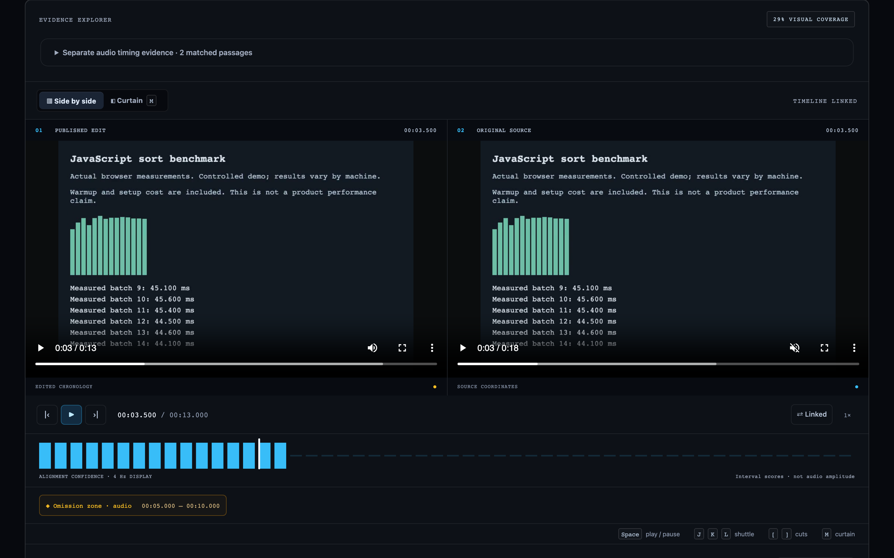
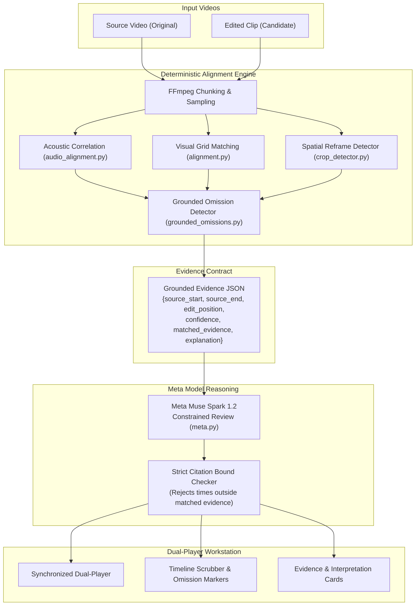
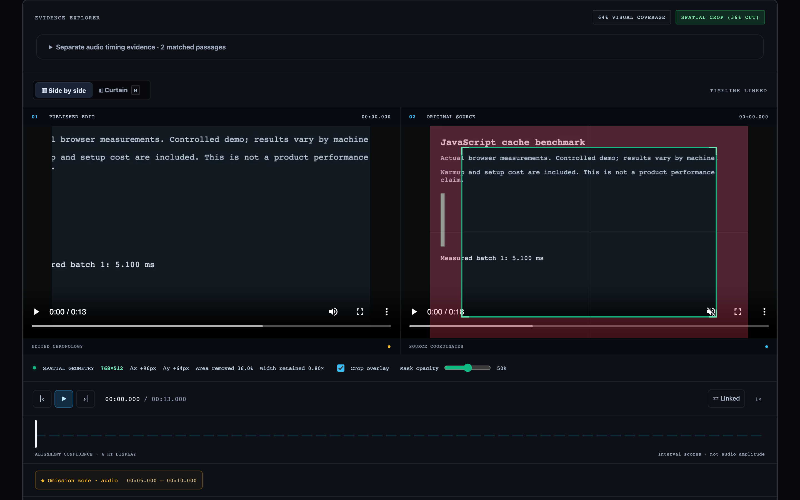
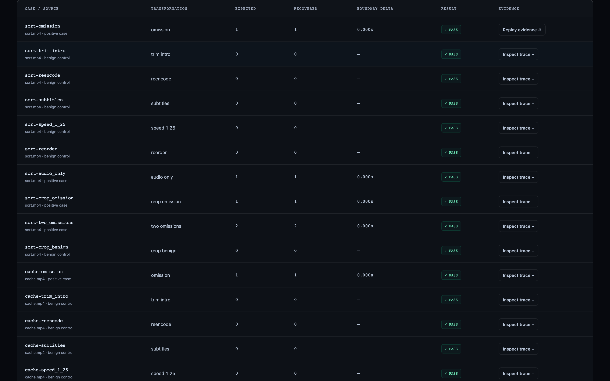
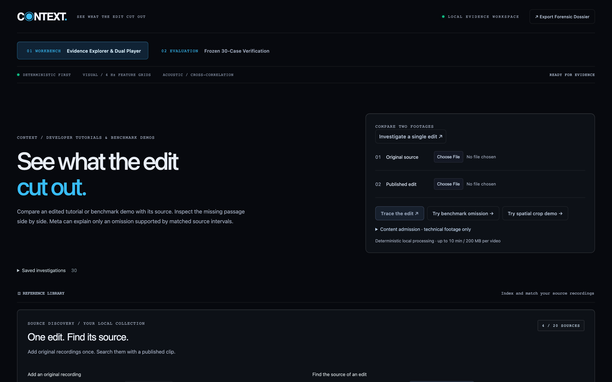

# CONTEXT

CONTEXT shows what an edit cut out of a technical video, side by side with the source.
Domain: developer tutorials, benchmark demos, and product claims.
Built for the Meta Global AI Developer Hackathon 2026.

### See the whole story.

A local video evidence workstation. Trace a published edit to a provided source, reconstruct the sequence,
reveal missing footage, and inspect timestamped Meta AI interpretation.

> 🎬 **Watch the 3-Minute Master Demo Video:**  
> - **In Repository:** [`demo-video/renders/context-demo-3min.mp4`](demo-video/renders/context-demo-3min.mp4) (render predates the latest script edits; size TBD, re-render pending)  
> - **Release download:** TBD (no release published yet)  
> - **Narration Script:** [`docs/demo-script.md`](docs/demo-script.md)



## Architecture

Deterministic first. The aligner (4 Hz spatial color sequence matching via `spatial-color-sequence-v2` and normalized acoustic cross-correlation) finds and timestamps the omissions it can align. The Meta model may **ONLY** explain an omission tied to a matched source interval. If the aligner finds no correspondence, the output is strictly `"no material omission"` with an abstention limitation. The model is not asked to discover omissions, and its output is rejected if it cites anything outside the grounded evidence.

Output evidence JSON per omission:
`{source_start, source_end, edit_position, confidence, matched_evidence, explanation}`.
Any explanation citing a time outside the bounded evidence window is strictly rejected.



## Interface Walkthrough & Real Use Cases

### 1. Synchronized Dual-Player Workbench (`01 WORKBENCH`)


- **Purpose:** Primary evidence workspace. Synchronizes the candidate published edit alongside the unedited source recording into an aligned timeline with an interactive 4 Hz visual confidence strip, audio waveforms, omission markers, and tabular millisecond readouts.
- **Real Run / Authored Case:** **Python Cache Latency Qualification Demonstration**
  - *The Footage:* Authored technical illustration displaying actual local microtimings (cold setup 0.83 ms; dictionary lookup 0.009 µs). A conditions panel at seconds 6–10 explicitly discloses `"WARM CACHE ONLY"`, `"COLD-START SETUP IS EXCLUDED"`, and `"Not an end-to-end speedup claim"`.
  - *The Temporal Edit:* Excises source seconds `00:06.000` to `00:10.000`, removing the qualification while leaving the measured lookup figure intact.
  - *The Detection:* The aligner recovers the exact 6–10 s deletion at edit position 6.000 s through **audio matching**; visual matching alone returned `insufficient_evidence` (`eval/hero-v1/results.json`). The soundtrack is a synthetic tone, so audio correspondence does not authenticate images.
  - *The Interpretation:* Bounded video excerpts of the source and edit, plus sparse timed frames from the same windows, went to **Meta Muse Spark 1.2**. The committed response is a **saved recording** (`eval/hero-v1/muse/response.json`), not a live re-run. Muse reads the qualification in source frames only, notes generic conditions in edited samples, and reports `inconclusive` on whether the qualification disappeared.

---

### 2. Spatial Evidence & Crop Calipers


- **Purpose:** Detects spatial reframing, aspect-ratio crops, and peripheral panel omissions.
- **Real Run / Authored Case:** **Cache Conditions Panel Spatial Cut**
  - *The Edit:* Retains `[0, 0, 960, 720]` of a `1280×720` frame, shaving off the rightmost 25% margin containing the test conditions panel.
  - *The Detection:* Deterministic OpenCV multi-scale template matching identifies the exact retained box and highlights omitted margins with HUD calipers.
  - *Meta SAM 3.1 Status:* SAM 3.1 is an experimental segmentation model. A frozen 10-crop chart-bar experiment passes on replay of saved responses (mean pixel recall 0.9995, mean IoU 0.844; `eval/execution-v1/sam-gate/rescored-results/results.json`); the original scoring run errored on mask parsing (`sam-gate/results/results.json`). On the cache qualification hero clip SAM returned zero masks (`eval/hero-v1/results.json`). Operational margin shading is computed strictly by deterministic OpenCV geometry.

---

### 3. Frozen Benchmark & Evaluation Matrix Hub (`02 EVALUATION`)


- **Purpose:** Transparency and reproducibility scorecard for frozen fixtures.
- **Real Run / Authored Case:** **30-Edit Scripted Benchmark Suite & 18 Benign Controls** (`eval/execution-v1/full-results/results.json`)
  - Evaluates 30 scripted FFmpeg edits across 3 CC0 benchmark videos (`sort.mp4`, `cache.mp4`, `serialize.mp4`) across 10 recipes.
  - **Empirical Results:** `100% Interval Recall` (15/15 intervals recovered across 12 positive cases), `0.0s Boundary Error`, `0.0% Benign False Alarms` across 18 benign controls (speedups, trims, subtitles, compression, reorder, benign crop). All edits are scripted cuts of authored benchmark recordings, not field footage.
  - **Scope disclosed:** results say nothing about unscripted edits; real-world noise differs from scripted cuts.

---

### 4. Verification Intake & Technical Catalog Ingestion


- **Purpose:** Single-input intake for candidate published edits, operator-reviewed technical catalog lookup, and domain policy enforcement.
- **Real Run / Authored Case:** **Single-Edit Investigation**
  - Users submit an edited video. The pipeline verifies content admission against the domain policy (developer tutorials, benchmarks, product claims).
  - Catalog retrieval compares admitted candidates deterministically.
  - Presets allow instant inspection of verified evidence cases and saved dossiers.

---

## Capabilities & Validation Matrix

| Capability | Component | Status | Empirical Evidence & Boundaries |
|---|---|:---:|---|
| **Temporal Omission Recovery** | 4 Hz spatial color sequence (`spatial-color-sequence-v2`) & normalized acoustic correlation | **Measured / Passing** | 15/15 intervals recovered across 12 positive cases in frozen `execution-v1` (30 cases total), 0.0 s mean boundary error, 0/18 benign alarms. Exact recovery of the 6–10 s deletion in the cache qualification hero clip, via audio matching; visual alone was `insufficient_evidence` (`eval/hero-v1/results.json`). Suite source: `eval/execution-v1/full-results/results.json`. |
| **Spatial Crop Bounds** | Multi-scale template matching (`crop_detector.py`) | **Measured / Passing** | Exact retained box `[0, 0, 960, 720]` (25% area cut) on cache crop fixture; caliper geometry isolates omitted margins. |
| **Grounded Semantic Review** | Meta Muse Spark 1.2 (`meta.py`, `context-review-v5-bounded-frames`) | **Integrated / Bounded** | Requests bounded to measured omission windows with sparse timed frames. Citations bounds-checked (`meta.py`). Hero response is a saved recording. Reads cache qualification, observes generic edit conditions, and reports `inconclusive`. Valid timestamps do not prove semantic accuracy. |
| **Screen-Content Segmentation** | Meta SAM 3.1 (`scripts/run_sam_gate.py`, `scripts/run_cache_qualification_sam.py`) | **Experimental** | Replay of 10 frozen chart-bar crops passes (mean pixel recall 0.9995, mean IoU 0.844; `sam-gate/rescored-results`). Zero masks on the hero panel (`eval/hero-v1/results.json`). Operational crop margins use OpenCV geometry, not SAM masks. |
| **Technical Source Discovery** | Registered catalog & local collection (`library.py`) | **Bounded Scope** | Ranks up to 4 registered technical sources + local collection (capped at 20). Untrusted captions rank metadata; deterministic correspondence independently selects media. Not internet-wide reverse search. |
| **Content Admission Gate** | Fail-closed domain policy (`domain_policy.py`) | **Enforced Policy** | Restricts to developer tutorials, benchmarks, product demos. Excludes politics, elections, news, wartime, public figures. Local operator receipts bind exact SHA-256; not an automatic classifier. |

## Frozen Evaluation Contract & Results

Thresholds fixed **BEFORE** inference runs (`eval/execution-v1/contract.json`): Interval Recall >= 80%, Benign False Alarm Rate < 10%.
Edits scripted from licensed source videos with FFmpeg; edit script writes ground-truth labels automatically.

### Summary Metrics

| Metric | Target Threshold | Baseline (10 edits) | Full Suite (30 edits) | Status |
|---|:---:|:---:|:---:|:---:|
| **Interval Recall** | &ge; 80.0% | **100.0%** (1.0) | **100.0%** (1.0) | **PASS** |
| **Boundary Error** | edit position &le; 1.0 s, IoU &ge; 0.5 | **0.00s** mean | **0.00s** mean | **PASS** |
| **Benign False-Alarm Rate** | < 10.0% | **0.0%** (0/5) | **0.0%** (0/18) | **PASS** |
| **Kill Switch Triggered** | Recall < 50% | **False** | **False** | **PASS** |

### Benchmark Results (30 Scripted Edits Across 3 Benchmark Sources)

| Case Category | Edit Recipe | Expected Omissions | Recovered | Benign | Result |
|---|---|:---:|:---:|:---:|:---:|
| **Omission Cuts** | `*-omission` | 1 | 1 | False | MATCH |
| | `*-two_omissions` | 2 | 2 | False | MATCH |
| | `*-audio_only` | 1 | 1 | False | MATCH |
| | `*-crop_omission` | 1 | 1 | False | MATCH |
| **Benign Controls** | `*-trim_intro` | 0 | 0 | True | NO FALSE ALARM |
| | `*-reencode` | 0 | 0 | True | NO FALSE ALARM |
| | `*-subtitles` | 0 | 0 | True | NO FALSE ALARM |
| | `*-speed_1_25` | 0 | 0 | True | NO FALSE ALARM |
| | `*-reorder` | 0 | 0 | True | NO FALSE ALARM |
| | `*-crop_benign` | 0 | 0 | True | NO FALSE ALARM |

*Full evaluation outputs committed to `eval/execution-v1/full-results/RESULTS.md` and `results.json`; the 10-edit baseline is `friday-results/`.*

## One-Command Run (Docker)

```sh
# Build and run with Docker
docker build -t context .
docker run -p 8000:8000 -e MODEL_API_KEY="your_api_key_here" context
```

Open http://127.0.0.1:8000.

## Reproducibility Commands

To independently reproduce the evaluation benchmarks:

```sh
# Run Friday 10-edit baseline
PYTHONPATH=backend .venv/bin/python scripts/execution_eval.py friday

# Run full 30-edit evaluation suite
PYTHONPATH=backend .venv/bin/python scripts/execution_eval.py full

# Replay SAM 3.1 crop gate benchmark
PYTHONPATH=backend .venv/bin/python scripts/execution_sam_gate.py replay

# Run full test suite (172 tests)
.venv/bin/pytest -q
```

## Local Development

Prerequisites: Python 3.12+ with compatible NumPy wheels, Node 20.19+ or 22.12+,
FFmpeg and FFprobe on PATH. Verified with Python 3.15 and Node 24.

```sh
python3 -m venv .venv
.venv/bin/pip install -r backend/requirements.txt
npm ci --prefix web
npm run build --prefix web
cp -n .env.example .env
# Set MODEL_API_KEY in .env for optional Meta review.
.venv/bin/uvicorn context_core.api:app --app-dir backend --env-file .env --host 127.0.0.1 --port 8000
```

Open http://127.0.0.1:8000.

- **Known pair:** upload an original recording and published edit, then click **Trace the edit**.
- **Hero demo:** click **Try hero demo (recorded response) →** to load the cache qualification case from `eval/hero-v1` with the saved Muse response.
- **Source discovery:** add original recordings to the local collection, then upload a published clip to automatically search and match candidates.

Click an omission to play the missing original interval. Linked playback follows
matches and jumps across cuts; reveal switches to independent source playback
and stops at the interval boundary. The original is muted during linked playback
to avoid overlapping audio. Incompatible containers/codecs receive H.264/AAC playback previews while original
evidence bytes and hashes remain unchanged. Saved investigations and valid interpretations survive
reload; the URL identifies a local case. Reports retain media hashes and methods.

Frontend development: `npm run dev --prefix web` alongside the API. Vite proxies
`/api` to port 8000; rebuild to update the production page.

## Verification

```sh
# Run full test suite (172 tests)
.venv/bin/pytest -q

# Build frontend and verify formatting
npm run build --prefix web
npm --prefix web run format:check

# Python lint and formatting checks
.venv/bin/ruff check backend scripts
.venv/bin/ruff format --check backend scripts
```

## Evidence Engine Modules

- `media.py`: media probing, audio waveform extraction, and timestamped 4 Hz RGB feature sampling.
- `audio_alignment.py`: normalized acoustic cross-correlation running at 2 kHz, detecting soundtrack discontinuities with 0.0 s boundary error on the scripted eval cuts.
- `alignment.py`: conservative sequence matching, ambiguity rejection, supported cuts, omissions, reordering, and repetition.
- `crop_detector.py`: multi-scale OpenCV template matching for crop/reframe detection (SAM 3.1 is experimental and not used for margins).
- `grounded_omissions.py`: strict verification enforcing that omissions must be grounded by deterministic matches on both sides.
- `meta.py`: bounded multimodal reasoning (Meta Muse Spark 1.2) with strict citation verification (rejects any claim citing times outside grounded evidence).
- `api.py`: FastAPI endpoints for analysis, the hero demo (`/api/demo/hero`), streaming video playback, and review caching.

## Meta Model Integration

CONTEXT strictly separates deterministic measurement from language model reasoning:

1. **Meta Muse Spark 1.2**: receives bounded video excerpts ($\le 30$ seconds, plus sparse timed frames from the same windows) corresponding strictly to deterministic omission intervals found by the aligner. If the aligner has no match, the model is never invoked. Any model explanation citing timestamps outside the grounded evidence window is rejected by `validate_explanation()`.
2. **SAM 3.1 (experimental, not in the core pipeline)**: passes only the frozen chart-bar replay and returned zero masks on the hero clip. Crop margins come from OpenCV geometry.
3. **Response Caching**: all model interpretations are hashed and cached against media bytes, prompt version, and finding ID, so the hero demo replays a recorded response.

## Scope & Epistemic Guardrails

- **Strict Non-Political Domain**: developer tutorials, benchmark demos, and product claims only. No politics, elections, news, war, or real public figures.
- **Abstention Over Accusation**: if an edit cannot be reliably aligned (e.g. extreme non-linear speed warping), CONTEXT reports `"insufficient evidence"` or `"no material omission"`. It is built to abstain rather than assert an omission without a deterministic match.
- **Local Workstation**: the app, alignment and media run on loopback (`127.0.0.1:8000`). When a `MODEL_API_KEY` is set, bounded excerpts and sampled frames tied to a matched omission are sent to the Muse API; without a key no media leaves the machine.

## Submission Information

- **Event**: Meta Global AI Developer Hackathon 2026
- **Track**: Solo / Indie Track
- **Submission Deadline**: November 4, 2026, 9:00 PM ET (November 5, 7:30 AM IST)
- **Primary Artifact**: 3-minute video demonstration (`docs/demo-script.md`) backed by reproducible benchmarks.

## Real-speech evaluation (eval/real-v1)

Nine FOSDEM 2022 Python-devroom talks (CC BY 2.0 BE; clipped and edited: first 270 s each), nine scripted edit recipes, 81 cases. Contract, sources and labels were committed before the pipeline ran; `eval/real-v1/results.json` is committed as produced. All edits are scripted cuts. Run: `scripts/fetch_real_v1.py`, then `scripts/real_v1_eval.py prepare|run`.

- **Result (scripted cuts):** interval recall 32/36 = 88.9% (threshold 80%, pass); benign false alarms 0/45 = 0% (threshold under 10%, pass); mean boundary error 0.125 s. Scored separately. The "0.0 s boundary error" figures elsewhere in this README apply to execution-v1 only.
- **Four misses, reported as produced:** three on one talk (middle cut, crop+cut, audio-only) where the unmatched gap on the edited side was 1.5 s against the aligner's 1.0 s limit (`grounded_omissions.py`), and one early cut on a talk whose first ~50 s have no audio match, so the cut read as a leading trim.
- **Upper bound:** with 0 false alarms in 45 benign cases, the rule-of-three 95% upper bound is about 6.7% (execution-v1: 0/18, about 16.7%), derived in `eval/upper_bounds.json` by `scripts/derive_upper_bounds.py`. Suites are not pooled.
- Deterministic aligner only: no Muse calls, no API cost. SAM is not used. A single Muse Voice Transcribe test on one clip returned turn-level timestamps (`startMs`/`endMs`) only, no word-level timing.
- Domain-admission gate (`domain_policy.py`) is a local, offline check of a byte-bound review (no API). The eval calls `analyze()` and `grounded_omissions()` directly and never invokes the gate, so it cannot reject cases. Product paths still require admission; these clips have no operator review on file.

## Built during the hackathon

- Repo history starts 2026-10-29; all 49 commits fall between 2026-10-29 and 2026-10-31, inside the Oct 27–Nov 4 window.
- Third-party tools and assets: FFmpeg and OpenCV (media and crop geometry); FOSDEM 2022 Python-devroom talks used as eval clips under CC BY 2.0 BE, with attribution in `eval/real-v1/sources.json` (clipped and edited; video files are not committed).
- Meta Muse Spark 1.2 API for bounded explanations (the hero response is a saved recording); Meta SAM 3.1 is experimental and not part of the core pipeline.
- The wider "universal video intelligence" vision (CONTEXT / CONTROL / PRELUDE / VEIL) is a concept, not built. Only CONTEXT exists in this repo.
