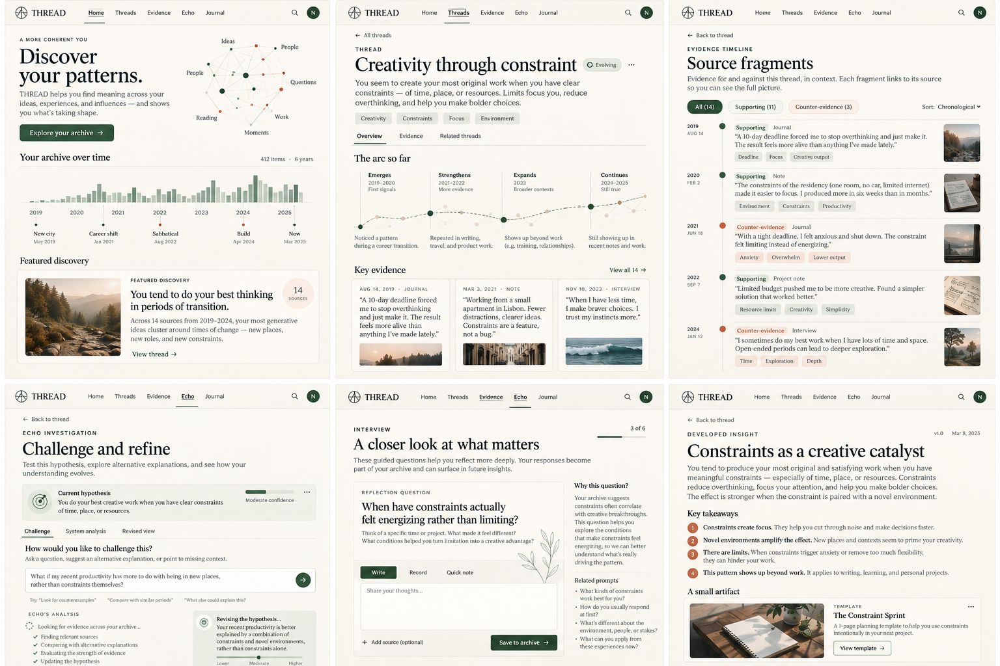

<div align="center">

# THREAD

### Find the threads running through your own story.

**Personal creative intelligence, grounded in your history.**

[Product brief](docs/PRODUCT.md) · [Architecture](docs/ARCHITECTURE.md) · [10-day plan](docs/PLAN.md) · [Demo flow](design/flows/demo-flow.md)

</div>

---

THREAD turns a person's multimodal history into **temporal memories**, then helps discover patterns, contradictions, evolution, and connections across domains. Every interpretation is investigated against evidence and counter-evidence. The person decides what it means. **Only a human-confirmed insight can become an artifact.**

<div align="center">



<sub>Early visual direction: Discover → inspect evidence → challenge → reflect → confirm → create. Sample interface copy and data are illustrative.</sub>

</div>

## The idea

Most creative tools start with a blank prompt. THREAD starts with the material of a life: notes, images, recordings, documents, and creative work. It looks for meaningful changes and recurring ideas over time, then makes its reasoning visible so the person can question it.

```text
Personal history
      ↓
Temporal memories with source provenance
      ↓
Evidence-backed discovery candidates
      ↓
Investigation, counter-evidence, and user interview
      ↓
Human-confirmed insight
      ↓
A useful, traceable creative artifact
```

## What makes a discovery trustworthy?

- **Evidence first.** Every candidate links back to dated source material.
- **Time matters.** Preserve sequence, change, and uncertainty about dates.
- **Skepticism is part of the flow.** Seek counter-evidence and alternative explanations.
- **The person decides.** Candidates are hypotheses, not facts; confirmation is explicit.
- **Creation comes later.** Artifacts must trace back to a confirmed insight.

## The hero experience

1. **Discover** a possible thread across a bounded personal archive.
2. **Inspect** the timeline, source fragments, and evidence on both sides.
3. **Challenge** the interpretation or add missing context.
4. **Reflect** through a small number of grounded interview questions.
5. **Confirm or revise** the insight in the user's own words.
6. **Create** one artifact that remains connected to its evidence.

## Day-0 repository

This repository is the product and engineering foundation for the hackathon. It contains planning documents and visual references; **product implementation starts on Day 1**.

| Path | Purpose |
|---|---|
| [`docs/PRODUCT.md`](docs/PRODUCT.md) | Product definition, user, and principles |
| [`docs/ARCHITECTURE.md`](docs/ARCHITECTURE.md) | Proposed components and model-provider boundary |
| [`docs/DISCOVERY_ENGINE.md`](docs/DISCOVERY_ENGINE.md) | Candidate families, evidence rules, and CLI contract |
| [`docs/DATA_MODEL.md`](docs/DATA_MODEL.md) | Initial provenance-aware data model |
| [`docs/EVALS.md`](docs/EVALS.md) | Evaluation dataset, rubric, and demo gate |
| [`docs/DEMO.md`](docs/DEMO.md) | Hero demo narrative and fallback |
| [`docs/PLAN.md`](docs/PLAN.md) | Oct 26–Nov 4 plan, P0/P1/P2 scope, and kill list |
| [`design/DESIGN_SYSTEM.md`](design/DESIGN_SYSTEM.md) | Visual direction and implementation cues |
| [`design/mockups/`](design/mockups/) | Initial six-screen direction board |
| [`design/flows/demo-flow.md`](design/flows/demo-flow.md) | Screen sequence and interaction boundaries |
| [`datasets/`](datasets/) | Reserved for synthetic, adversarial, and consented evaluation fixtures |
| [`backend/`](backend/) | Reserved for API, discovery services, and CLI |
| [`apps/web/`](apps/web/) | Reserved for the web client |

## Proposed stack

| Layer | Day-0 proposal |
|---|---|
| Web | Next.js + TypeScript |
| API and discovery | Python + FastAPI, with a CLI over the same core services |
| Persistence and retrieval | PostgreSQL + pgvector |
| Model integration | Meta Model API behind a typed provider adapter |

These choices are proposals to validate early. Confirm supported modalities, access, terms, and reliability before depending on live model calls. Keep a deterministic fixture path for repeatable development and demo fallback.

## The CLI-first gate

The discovery engine must work from the CLI **before frontend workflow development begins**. First prove that fixtures can produce structured, source-linked candidates with uncertainty and counter-evidence. Then build the web experience on top of that contract.

## Hackathon scope

- **P0:** temporal memories and provenance; CLI discovery; evidence and counter-evidence; one interview with confirm/revise/reject; one artifact gated by confirmation; minimal end-to-end web flow; deterministic fallback.
- **P1:** more discovery families, richer timeline and connection views, additional modalities or artifact types when P0 is stable.
- **P2:** continuous sync, broad integrations, mobile, production multi-tenancy, autonomous actions, and a general-purpose creation studio.

See the [full 10-day plan](docs/PLAN.md) for milestones and the kill list.

## Data and privacy

Use only bounded, user-provided or synthetic data for the prototype. Real personal data requires explicit consent, careful minimization, and local handling; never commit private datasets. Keep source provenance visible, avoid sensitive-trait inference, and make source removal invalidate derived memories and claims.

## Current status

**Day 0 — product and design foundation.** No product features are implemented yet. The next milestone is a fixture-backed CLI discovery slice and an early Meta Model API capability check.

---

<div align="center">

**THREAD** · Understand the story before you make something from it.

</div>
