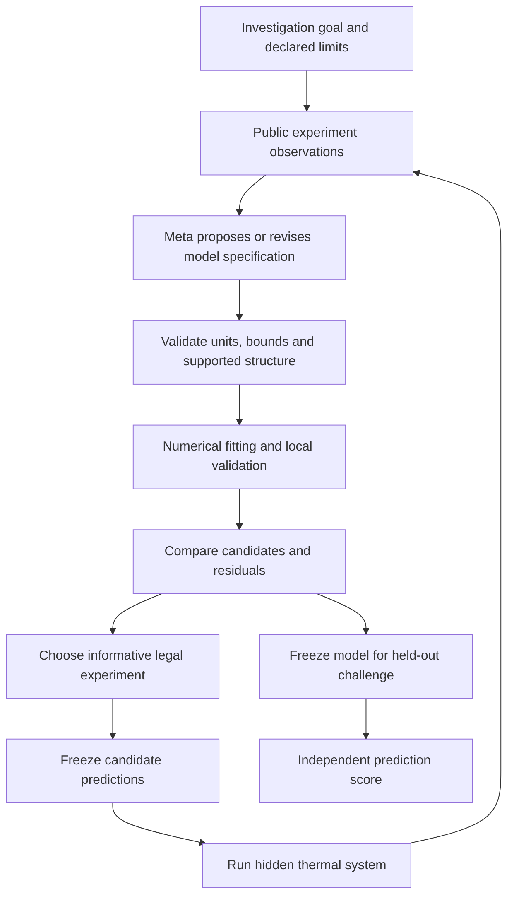

# Architecture and implementation concepts

## Existing-stack decision

Reuse the existing project's Python numerical/backend environment and narrow Meta adapter where suitable. Next.js can host the investigation workspace after the scientific loop works. This is an extension of an established non-eve stack; no new agent framework or infrastructure migration is needed. Existing SHOWME product UI is not the new specification.

## Core loop

## Module responsibilities

- `contracts`: typed action, observation, candidate, fitted model and ledger schemas. Reject NaN, impossible durations, duplicate IDs, unknown units and malformed schedules.
- `lab_service`: hidden world in a separate process, state progression, action limits, experiment budget and immutable observation records. Only public outputs are exposed.
- `model_spec`: bounded declarative thermal graph/term representation. Start with one/two thermal nodes, thermal coupling, heater inputs and optional sensor lag. State clearly which families are supplied by humans.
- `fit`: numerical integration and constrained parameter estimation; residuals and held-out-segment validation. Parameter bounds and initialization failures are logged. Do not pass hidden simulator parameters as fit initialization.
- `design`: candidate experiment predictions, disagreement/identifiability diagnostics, action selection and budget accounting. The same implementation/tools are available to comparison agents where the protocol requires them.
- `investigator`: Meta tool loop, candidate revision history, stop/continue decisions and concise evidence-linked explanations. Persist actions and outcomes so a process restart cannot repeat a costly experiment inadvertently.
- `evaluate`: sealed challenges, paired-run comparisons and plots. This is physical-system evaluation, not a developer QA product.
- `api`: session creation, proposed experiment, execution, candidate inspection, challenge and export.
- `web`: a system schematic and predictions that update from actual stored events.

## Minimal objects

`Experiment`: ID, session, proposed schedule, intended discriminating question, budget reservation, prediction references, execution status, timestamps and actual cost.

`Observation`: experiment ID, simulated measurement time, Q1/Q2, measured T1/T2, units, noise metadata and source kind (simulation/replay/hardware).

`ModelSpec`: version, supported nodes/terms, parameter names/bounds, measurement mapping, proposed-by provenance and linked observations. No arbitrary Python execution in V1.

`FitResult`: model version, observation IDs, parameter estimates, numerical status, residuals, local validation metrics and runtime. Parameters are estimates; unsupported precision is not displayed.

`Prediction`: immutable model version, input schedule, predicted output samples, creation timestamp and optional interval method. Must precede challenge measurements.

`InvestigationEvent`: append-only ID, parent event, model/tool version, action, evidence references, result and usage. A result never overwrites a prior model's prediction.

`ChallengeResult`: frozen model/prediction ID, sealed input reference, error by sensor, threshold version and pass/fail/unsupported status.

## What Meta does

Use the already integrated Muse Spark adapter after checking its actual structured-output/tool behavior. It reads public observations, fit diagnostics and candidate comparisons, proposes a declarative structure, identifies unresolved explanations, chooses the investigation goal for the next experiment and reacts to surprising measurements.

Arithmetic, numerical optimization, physics integration, model validity, experiment limits and scores are computed by code. Avoid adding SAM, image generation or voice solely to increase integration count. A voice goal can be added later if the full loop already works.

## Isolation and persistence

Do not execute model-generated code. Compile only supported declarative terms. Bound numerical runtimes and parameter ranges. The agent process cannot access evaluator filesystem/configuration or unrestricted shell tools. Hidden simulation and candidate predictions must be genuinely distinct; rendering the same trajectory twice is not validation.

Use small local JSON/SQLite records after inspecting existing dependencies. Preserve model versions, observation provenance and cost logs. A budget reservation plus stable experiment ID prevents duplicate execution on resume.

## Main engineering lessons

1. System identification: infer a predictive model from controlled inputs and measured outputs.
2. Identifiability: different parameters or structures can explain the same available measurements.
3. Experimental design: select interventions where explanations disagree rather than repeatedly confirming the current fit.
4. Model mismatch: low training error can coexist with bad future predictions.
5. Evaluation isolation: future challenge observations must remain unavailable until predictions are committed.

For this hackathon, prior explicit execution-first instructions apply: the assistant implements and explains these decisions without requiring a user coding exercise to unblock progress. Human participation is most useful for reviewing whether the goal and displayed evidence are understandable.
