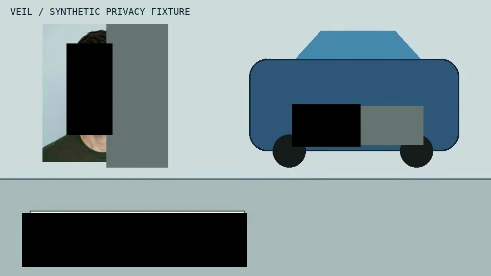

# VEIL

**Detect. Redact. Verify.**

VEIL is an embeddable video privacy engine. It identifies sensitive visual and spoken information, renders redactions, inspects the exported file and repairs detected residual exposures. Automated checks do not guarantee that a video has no leaks.

## Current result: a real 18-second export

[Play the corrected MP4](artifacts/smoke-001/protected.mp4) · [Original synthetic clip](artifacts/smoke-001/input.mp4) · [Results](artifacts/smoke-results.json) · [Receipt](artifacts/smoke-001/receipt.json)



Real Meta requests tracked a fictional face and a fake plate. Voice returned speech timestamps; FFmpeg muted the spoken number. Spark inspected the first export and found an unprotected printed number. The first repair covered one digit and failed its audit. A full-field repair then passed three sampled-frame reviews. Local evaluation checked all 180 frames for the fixture's visible plate and printed-digit cover regions and checked the audio samples.

**Limitations:** one composited fixture; no real-camera benchmark, precision/recall study, OCR audit, HTTP API or SDK yet. Plate concept detection failed and required Spark localization. Voice misread the number, so audio muting is deliberately broad. Face masks were decoded but rendering uses padded boxes, not contour-exact masks. Final review sampled three frames. These results are not a privacy guarantee.

## Run local checks without model charges

Requires Python 3.12+, FFmpeg and ffprobe on PATH. The fixture generator additionally needs macOS `say`.

```sh
python3.12 -m venv .venv
.venv/bin/python -m pip install -e '.[test]'
.venv/bin/python -m pytest -q
.venv/bin/python scripts/check_media.py --root artifacts/smoke-001
```

## Run the bounded API experiment

Set `MODEL_API_KEY` in a local uncommitted `.env`. Scripts also accept `--env-file`. Only use synthetic or explicitly consented media. Fresh output directories are required: ledgers refuse duplicate calls and automatic retries are disabled. Do not delete the archived ledger to rerun it.

The recorded sequence was: `generate_face.py` → `make_synthetic_clip.py` → `smoke_models.py` → `seed_plate.py` → `render_smoke.py` → `inspect_export.py` → `repair_smoke.py` (preserved failed repair) → `repair_field.py` (corrected export) → `check_media.py`. Each script accepts `--help`; generation uses `--output`, remaining stages use `--root`. Run scripts with `PYTHONPATH=src` or after editable installation. This is a staged experiment harness, not yet a general one-command pipeline.

Full request details, formats, restrictions, latency and cost evidence: [Model capabilities](docs/MODEL_CAPABILITIES.md). Product scope: [Product](docs/PRODUCT.md). Progress: [Implementation](docs/IMPLEMENTATION.md).

## Data handling

Local artifacts contain only synthetic imagery, fake identifiers and synthetic speech. Meta receives the media identified in each call ledger. Original detection results and evaluation truth are excluded from exported-frame audit prompts. Uploaded files are deleted after use where supported; cleanup records are retained. Files remain subject to Meta's service policies; this is not a fully local pipeline or a zero-retention claim. Never commit credentials or actual personal data.
