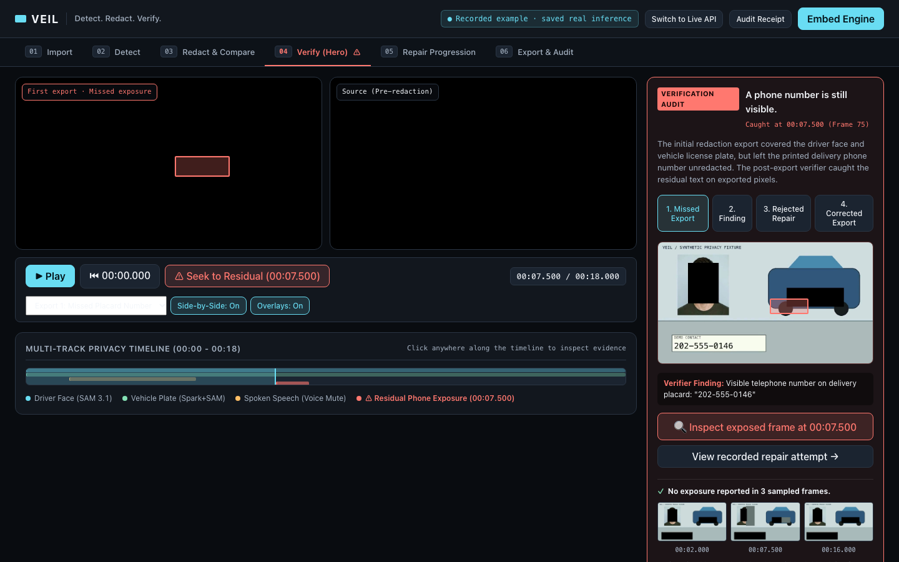
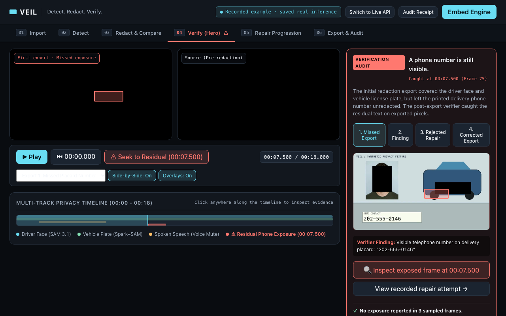
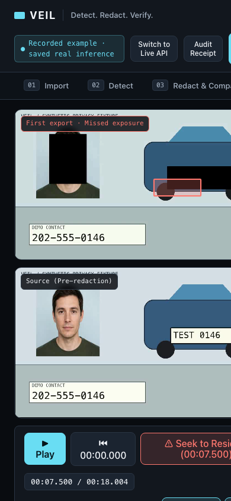
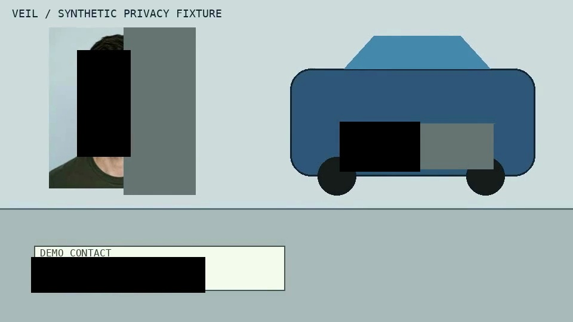

# VEIL Web — Reference Demonstration Interface

**Detect. Redact. Verify.**

This package contains the official reference interface for VEIL: an embeddable multimodal video privacy engine. It provides a precision video inspection desk to review automated detections, inspect time-aligned video/audio redactions, catch residual privacy leaks on exported pixels, and view verifiable cryptographic receipts.

---

## Operating Modes

1. **Recorded Demonstration (Saved Real Inference)**
   - Operates fully standalone using saved real responses from Meta SAM 3.1, Muse Voice ASR, and Muse Spark 1.3 models from smoke test `smoke-001`.
   - **Hero Moment:** Highlights an omitted printed telephone number caught at timestamp `00:07.500` on an exported delivery placard, steps through the rejected single-digit repair attempt, and plays the corrected whole-field export.
   - Shows a 3-frame sampled review pass with explicit audit scope disclosure: *"Reviewed at 00:02.000, 00:07.500 and 00:16.000. Other frames may contain missed exposures."*

2. **Live Engine API Mode**
   - Connects to the local loopback engine at `http://127.0.0.1:8020` via Vite's development proxy.
   - Allows uploading local videos (constrained to 100 MiB, 60s, 1080p, audio required).
   - Uploads local media. Processing arbitrary uploads through this interface remains incomplete; use the API/SDK with detected or reviewed targets. Export checks report their scope and do not guarantee privacy.

---

## Quickstart

Requires Node.js 18+ (verified on Node v24).

```bash
cd veil/web

# Install dependencies
npm install

# Start development server on http://127.0.0.1:3000
npm run dev

# Run unit tests (Node built-in test runner)
npm test

# Typecheck and build production bundle
npm run build

# Preview production build
npm run preview
```

---

## Test Suite

Tests enforce honest reporting and audit constraints:
- `tests/recorded-example.test.mjs`: Ensures all 4 MP4 progression stages exist, provider confidence remains strictly null (not invented), failed single-digit repair is preserved, and the 3-sample disclaimer is displayed.
- `tests/api-client.test.mjs`: Tests client-side 100 MiB upload guardrails and URL routing.

```bash
npm test
```

---

## Screenshots

| Desktop Viewport (1440×900) | Laptop Viewport (1280×800) |
|---|---|
|  |  |

| Mobile Viewport (390×844) | Corrected Export Frame (00:07.600) |
|---|---|
|  |  |
